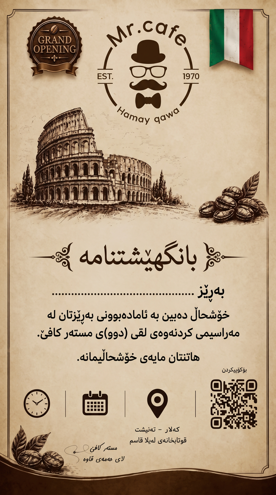

# دروستکەری بانگهێشتنامەی مستەر کافێ

وێبپەیجێکی ساکاری static ـە (بێ build، بێ سێرڤەری پێویست بۆ کۆد) کە **ناوی میوان**
لەسەر وێنەی بانگهێشتنامەکە دەنووسێت — ڕاستەوخۆ لەسەر ئەو خاڵانەی بەردەم «بەڕێز» —
و **دەقی واتساپ**یش بۆ هەمان ناو ئامادە دەکات. دواتر بە یەک کلیک وێنەکە دادەگرێت و
دەقەکە کۆپی دەکات.



---

## ١) دەستپێکردن (خێراترین ڕێگا)

```bash
cd ~/Projects/mrcafe-invite
./start.sh          # → http://localhost:8000
```

`start.sh` سێرڤەرێکی ناوخۆیی (python http.server) ڕادەگرێت و وێبگەڕەکەش دەکاتەوە.
بە دەستی، بێ سکریپت:

```bash
python3 -m http.server 8000 --bind 127.0.0.1
# پاشان: http://localhost:8000
```

### ⚠️ بۆچی ناتوانم تەنها `index.html` بکەمەوە؟

ئەگەر فایلەکە بە دوو کلیک بکەیتەوە (`file://…/index.html`)، وێبگەڕەکان کانواس
«پییس» دەکەن (`Tainted canvases may not be exported`) و **داگرتنی وێنە کار ناکات**.
لەبەر ئەوە: یان `./start.sh` بەکاربهێنە، یان وێبپەیجەکە لەسەر هۆستێکی static
بڵاوبکەرەوە (خوارەوە ببینە). پێشبینین لە هەر حاڵەتێکدا کار دەکات.

---

## ٢) چۆن بەکاریدەهێنم

1. **ناوی میوان** بنووسە → پێشبینین دەستبەجێ نوێ دەبێتەوە.
2. **دەقی نامە** هەڵبژێرە (دوو دەق، وەک لە کۆدی پێشوو).
3. **داگرتنی وێنە** → فایلی `MrCafe_Invitation_<ناو>.jpg` (١٥٣٦ × ٢٧٥٢ پیکسڵ).
4. **کۆپیکردنی دەق** → لە واتساپ پەیست بکە.
5. لە «چەند ناو بە یەک جار» دا لیستێک ناو بنووسە (هەر ناوێک لە دێرێک) و
   **داگرتنی هەموو وێنەکان** دابگرە. وێبگەڕەکە لەوانەیە جارێک مۆڵەتی
   «چەند داگرتن» بپرسیت.

کورتەبڕەکان: `Ctrl + Enter` = داگرتنی وێنە، `Ctrl + C` = کۆپیکردنی دەق
(کاتێک فۆکس لەسەر خانەیەکی نووسین نییە).

---

## ٣) ڕێکخستنی شوێن و قەبارەی ناو

دوو ڕێگا هەیە:

**أ) لە پەڕەکەوە** — «ڕێکخستنی وردی» بکەرەوە: قەبارەی فۆنت، بەرزی، ناوەندی
ئاسۆیی و ڕەنگی ناو. هەموو گۆڕانکارییەکان لە `localStorage` پاشەکەوت دەکرێن.

**ب) لە کۆدەوە** — سەرەتای `app.js`، بلۆکی `CFG`:

```js
const CFG = {
  imageSrc: "new_invite_bg.jpg", // وێنەی باکگراوند (لە تەنیشت index.html)
  centerX: 0.445,   // ناوەندی ئاسۆیی خاڵەکان
  baselineY: 0.585, // بەرزی نووسین (سەر خاڵەکان)
  fontRatio: 0.055, // قەبارەی فۆنت = 0.055 × پانی وێنە ≈ ٨٤px
  maxWidthRatio: 0.49,
  color: "#2b1a12",
};
```

> ### پێوانەی خاڵەکان (لەسەر وێنەی ١٥٣٦ × ٢٧٥٢)
> خاڵەکانی بەردەم «بەڕێز» لەم شوێنەدان:
> * ئاسۆیی: `x = 291 … 1077` → ناوەند `684` = **٠.٤٤٥ی پانی**
> * بەرزی: `y ≈ 1629 … 1639` → بنەڕەتی نووسین `≈ 1610` = **٠.٥٨٥ی بەرزی**
>
> لەبەر ئەوەی ناوەند لە ٠.٤٤٥دایە (نەک ٠.٥)، ناوەکە بە `canvas.width / 2` نادەنرێت —
> دەکەوێتە سەر «بەڕێز». هەروەها ناوەندکردن بە **مەرەکەبی ڕاستەقینەی نووسین** دەکرێت
> (پێوانەی `getImageData`)، بۆیە بۆ کوردی و ئینگلیزی هەردووکیان ڕێک دەکەوێت و
> ئەگەر ناوەکە درێژ بوو، فۆنت خۆکارانە بچووک دەبێت هەتا لە خاڵەکان تێپەڕ نەکات.

---

## ٤) بڵاوکردنەوە (بۆ ناردن بۆ میوانەکان)

هەموو پێویستییەک ٤ فایلە. فۆڵدەرەکە بە تەواوی static ـە، بۆیە:

* **Netlify Drop** — فۆڵدەرەکە فڕێبدە ناو <https://app.netlify.com/drop>
* **Cloudflare Pages / Vercel / GitHub Pages** — فۆڵدەرەکە وەک خۆی بڵاوبکەرەوە
* هیچ `npm install` و build پێویست نییە.

---

## ٥) فایلەکان

```
mrcafe-invite/
├── index.html                     # پەڕەکە (RTL، کوردی)
├── styles.css                     # ڕەنگ و ڕیزبەندی
├── app.js                         # وێنەکێشان + دەق + داگرتن
├── new_invite_bg.jpg              # وێنەی بانگهێشتنامە (١٥٣٦ × ٢٧٥٢)
├── fonts/
│   ├── NotoNaskhArabic-Bold.woff2
│   └── NotoNaskhArabic-Regular.woff2
├── start.sh                       # سێرڤەری ناوخۆیی + کردنەوەی وێبگەڕ
└── README.md
```

---

## ٦) تێبینییەکان

* وێنەی داگیراو JPEG ـە (≈٩٤٠ کیلۆبایت). واتساپ لەوانەیە چڕی بکاتەوە؛ ئەگەر
  دەتەوێت بێ کێشە بگات، وەک **Document/فایل** بینێرە نەک وەک وێنە.
* دەقەکان لە `TEMPLATES` (ناوەڕاستی `app.js`) دان؛ زیادکردن/دەستکاریکردنیان
  ئاسانە. هێڵی شوێن (`LOCATION_LINE`) لە هەمان فایلە.
* فۆنتی `Noto Naskh Arabic` لەگەڵ پڕۆژەکەدایە، بۆیە لەسەر هەموو ئامێرێک
  (مۆبایل، ویندۆز، لینوکس) هەمان شێوە دەردەکەوێت.
* هیچ داتایەک بۆ هیچ سێرڤەرێک نانێردرێت؛ هەموو کارەکە لە وێبگەڕەکەدا ئەنجام دەدرێت.
